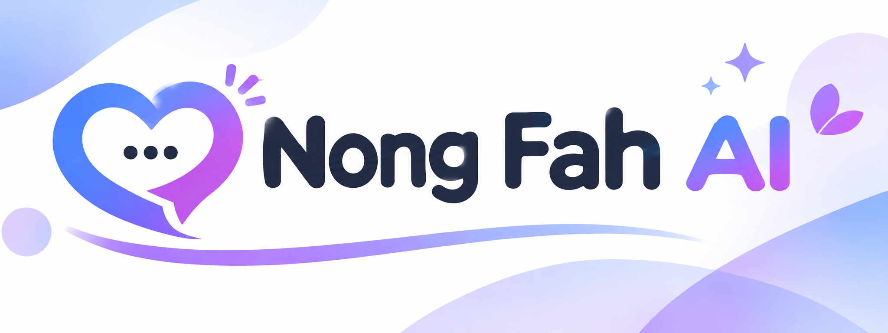

<div align="center">
  

  <h1>น้องฟ้า (Nong Fah AI)</h1>

  <p>พื้นที่เล็ก ๆ สำหรับคนที่อยากมีใครสักคนรับฟัง โดยไม่ต้องกลัวว่าจะถูกตัดสิน</p>
</div>

---

## เกี่ยวกับโปรเจกต์

บางครั้งเราก็มีเรื่องที่อยากเล่า แต่ไม่รู้ว่าจะเริ่มพูดกับใครดี

อาจเป็นเรื่องความสัมพันธ์ ครอบครัว สุขภาพจิต หรือเรื่องส่วนตัวที่ยังไม่พร้อมจะเล่าให้คนรอบตัวฟัง

นั่นเป็นจุดเริ่มต้นของ **น้องฟ้า (Nong Fah AI)**

ผมอยากลองสร้างพื้นที่ที่คนสามารถเข้ามาพูดคุยได้อย่างสบายใจ ไม่ต้องกลัวว่าจะถูกมองไม่ดี หรือถูกตัดสินจากสิ่งที่ตัวเองกำลังเผชิญอยู่

น้องฟ้าเป็นแชทบอท AI ที่ใช้ LLM ในการพูดคุย และให้ความสำคัญกับความปลอดภัยของผู้ใช้งาน โดยเฉพาะเมื่อมีข้อความที่อาจเกี่ยวข้องกับสถานการณ์เสี่ยงหรือเหตุฉุกเฉิน

โปรเจกต์นี้ไม่ได้ตั้งใจจะสร้าง AI ที่ตอบได้ทุกอย่าง แต่อยากทำให้การพูดคุยกับใครสักคนเป็นเรื่องที่เข้าถึงได้ง่ายขึ้น

## ฟีเจอร์หลัก

- **Crisis Detection** — ตรวจจับข้อความที่อาจเกี่ยวข้องกับการทำร้ายตัวเอง ความรุนแรงในครอบครัว และสถานการณ์เสี่ยงอื่น ๆ รองรับทั้งภาษาไทยและภาษาอังกฤษ
- **Emergency Resources** — แสดงช่องทางขอความช่วยเหลือ เช่น 1323, 1669, 1387 และ 1300 เมื่อพบข้อความที่เข้าข่ายความเสี่ยง
- **Tone Mirroring & Intent Engine** — ปรับรูปแบบการตอบให้เข้ากับผู้ใช้ ทั้งระดับภาษา ความยาวของข้อความ และลักษณะการพูดคุย
- **Output Moderation** — ตรวจสอบคำตอบจาก AI ก่อนส่งกลับ เพื่อช่วยลดโอกาสที่จะแนะนำสิ่งที่ไม่เหมาะสมหรืออาจเป็นอันตราย
- **Operator Alerts** — รองรับการแจ้งเตือนผ่าน Discord หรือ Slack Webhook เมื่อพบเหตุการณ์ระดับ Tier 2/3 โดยออกแบบให้ส่งเฉพาะ Session Hash ไม่ส่งข้อความสนทนาไปกับการแจ้งเตือน
- **Privacy First** — พยายามเก็บข้อมูลให้น้อยที่สุด ไม่จำเป็นต้องใช้ชื่อจริง และไม่มีระบบบันทึกประวัติแชทลงฐานข้อมูล
- **Sliding Window Memory** — สรุปบริบทของบทสนทนาที่ผ่านมา เพื่อให้ AI พูดคุยต่อได้แม้แชทจะยาวขึ้น
- **Safety UI** — มี Auto-Lock เมื่อละหน้าจอไว้ 15 นาที, Quick Exit และรองรับการติดตั้งเป็น PWA
- **Fallback Mode** — หากไม่ได้ตั้งค่า API Key สามารถใช้ Rule-based Engine ได้ โดยไม่ต้องเชื่อมต่อ LLM ภายนอก

## เทคโนโลยีที่ใช้

โปรเจกต์นี้เลือกใช้เทคโนโลยีที่ดูแลและพัฒนาต่อได้ไม่ยาก

- **Backend:** Node.js, Express
- **Frontend:** HTML, CSS, Vanilla JavaScript
- **AI Integration:** OpenAI-compatible API เช่น OpenAI, Groq และ Ollama
- **Session Storage:** In-memory Session Store
- **Database:** ไม่มีการใช้ฐานข้อมูลในรูปแบบปัจจุบัน

## โครงสร้างโปรเจกต์

```text
nong-fah-ai/
│
├── assets/
│   └── logo.png
│
├── index.html
├── package.json
├── .env.example
│
├── crisis.js
├── tone.js
├── output_guard.js
├── alerting.js
├── resources.js
├── llm.js
│
└── server.js
````

## วิธีติดตั้ง

### 1. Clone โปรเจกต์

```
git clone https://github.com/xeno312/nong-fah-ai.git
cd nong-fah-ai
```

### 2. ติดตั้ง Dependencies

```
npm install
```

### 3. ตั้งค่า Environment

คัดลอก `.env.md` เป็น `.env`

```
cp .env.md .env
```

หากต้องการทดลองใช้ Fallback Mode โดยไม่เชื่อมต่อ AI ภายนอก สามารถตั้งค่าได้ดังนี้

```
LLM_API_KEY=none
LLM_BASE_URL=none
LLM_MODEL=none
PORT=8000
ALERT_WEBHOOK=
```

หากต้องการเชื่อมต่อ LLM จริง สามารถใช้ผู้ให้บริการที่รองรับ OpenAI-compatible API ได้

ตัวอย่างการตั้งค่า Groq:

```
LLM_API_KEY=gsk_xxxxxxxxxxxxxxxxx
LLM_BASE_URL=https://api.groq.com/openai/v1
LLM_MODEL=openai/gpt-oss-120b
PORT=8000
ALERT_WEBHOOK=
```

### 4. เริ่มเซิร์ฟเวอร์

```
npm start
```

เปิดเบราว์เซอร์แล้วเข้าไปที่:

[http://localhost:8000]

## Environment Variables

| Variable        | รายละเอียด                  | ค่าเริ่มต้น |
| --------------- | --------------------------- | ----------- |
| `LLM_API_KEY`   | API Key สำหรับเชื่อมต่อ LLM | `none`      |
| `LLM_BASE_URL`  | URL ของ API Provider        | `none`      |
| `LLM_MODEL`     | ชื่อโมเดลที่ต้องการใช้      | `none`      |
| `PORT`          | Port สำหรับเซิร์ฟเวอร์      | `8000`      |
| `ALERT_WEBHOOK` | Discord / Slack Webhook     | ว่าง        |

## ความปลอดภัยและความเป็นส่วนตัว

เรื่องความเป็นส่วนตัวเป็นสิ่งที่ผมให้ความสำคัญตั้งแต่เริ่มทำโปรเจกต์นี้

น้องฟ้าถูกสร้างมาเพื่อรับฟังและพูดคุย ไม่ได้มีไว้เพื่อแทนที่แพทย์ นักจิตวิทยา หรือผู้เชี่ยวชาญด้านสุขภาพจิต

แนวทางที่ใช้ในการออกแบบมีดังนี้

1. ไม่บันทึกประวัติแชทลงฐานข้อมูล — ข้อมูลการสนทนาเก็บไว้ในหน่วยความจำของเซิร์ฟเวอร์ และจะถูกล้างเมื่อเซิร์ฟเวอร์ปิดหรือ Session หมดอายุ
2. เก็บข้อมูลเท่าที่จำเป็น — ไม่จำเป็นต้องใช้ชื่อจริง และพยายามหลีกเลี่ยงการเก็บข้อมูลส่วนตัวที่ไม่จำเป็น
3. ไม่มีระบบนำแชทไปฝึกโมเดลของโปรเจกต์เอง — อย่างไรก็ตาม การจัดการข้อมูลโดยผู้ให้บริการ LLM ภายนอกขึ้นอยู่กับนโยบายของผู้ให้บริการนั้น
4. ไม่ใช่เครื่องมือวินิจฉัยโรค — ไม่สามารถวินิจฉัยโรค สั่งยา หรือใช้แทนคำแนะนำจากผู้เชี่ยวชาญได้
5. ให้ความสำคัญกับเหตุฉุกเฉิน — หากพบข้อความที่อาจเกี่ยวข้องกับความเสี่ยง ระบบจะช่วยแสดงช่องทางติดต่อหน่วยงานที่สามารถให้ความช่วยเหลือได้

## การมีส่วนร่วม

โปรเจกต์นี้ยังมีหลายส่วนที่สามารถพัฒนาต่อได้ ถ้าใครสนใจอยากช่วยปรับปรุงหรือเสนอไอเดียเพิ่มเติม ยินดีเลยครับ

สิ่งที่อยากให้ช่วยกันเป็นพิเศษ:

- เพิ่มข้อมูลสายด่วนและโรงพยาบาลในแต่ละจังหวัด (`resources.js`)
- ปรับปรุงการตรวจจับข้อความเสี่ยง โดยเฉพาะภาษาไทย (`crisis.js`)
- ช่วยแปลหรือปรับข้อความบนเว็บไซต์
- ปรับปรุง UI/UX ให้ใช้งานง่ายขึ้น
- แจ้ง Bug หรือเสนอฟีเจอร์ใหม่ ๆ

สามารถเปิด Issue หรือส่ง Pull Request เข้ามาได้เลยครับ

## License

โปรเจกต์นี้เผยแพร่ภายใต้ MIT License สามารถนำไปใช้งาน แก้ไข และพัฒนาต่อได้ตามเงื่อนไขของ License

```

**หมายเหตุ:** ข้อมูลฟีเจอร์ โครงสร้างไฟล์ และคำสั่งติดตั้งใน README นี้ยึดตามรายละเอียดที่ให้มา ควรตรวจสอบกับโค้ดจริงอีกครั้งก่อนเผยแพร่ โดยเฉพาะเรื่องการเก็บข้อมูล, Session หมดอายุ, Crisis Detection และ Fallback Mode เพื่อไม่ให้ README ระบุเกินกว่าที่ระบบทำได้จริง
```
